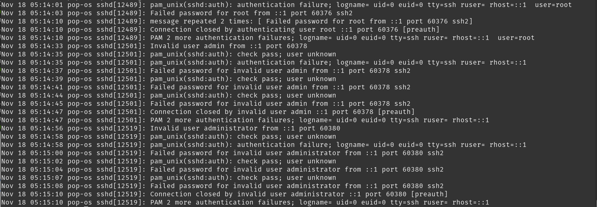
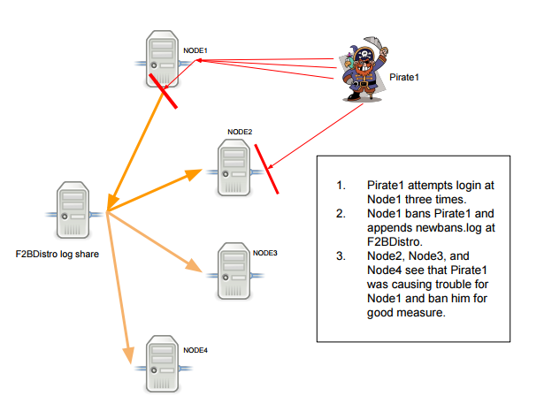

# Intrusion Detection and Prevention (IDS/IPS)

* Overview
* Host vs Network based
* Signature vs Anomaly based
* Firewall vs IDS vs IPS
* Where IDS fits: incident response and compliance
* Examples

---

# What it is

Intrusion detection and prevention systems at their core do the following:

* monitor systems or networks for policy violations
* report/log all violations
* perform/execute some action based on violations (IPS)

---

# Host Intrusion Detection Systems (HIDS)

* Operates on a host system
* Monitors network traffic in and out of system
* Monitors logs and files on the system
  * If critical files change, error/report
  * If logs show patterns known as attack, error/report

---

`/var/log/auth.log`



---

# How to move from detect to protect

{height=15%}

* detect (multiple failed login attempts)
* report (email admin/ log in central location)
* protect (use `iptables` to block all communication from that IP address)

Works with almost anything that has an authentication log file

---



---

# HIDS beyond logs

### Can detect more intrusions than just inspecting logs.

* File integrity monitoring (tripwire)
  * `/sbin`, `/bin`, `/usr/bin`, everything except `/home`
  * `C:\Windows`, `C:\Program Files`, everything except `C:\Users`
  * If files change in these directories, this could be considered an anomaly/outside the norm
* Binary analysis
  * Look for already known signatures/hashes/patterns of malicious activity or files

Modern HIDS on steroids: *Endpoint Detection and Response* (EDR)

---

# Signature vs Anomaly detection

### Signature based detection (binary analysis and others)

* assumes that we know what we are looking for
* assumes we (or whoever wrote our rules) have seen this before
* we need a good rule set/ signature database, and it will only grow...
* fewer false positives, but novel (zero-day) attacks are missed

### Anomaly based detection (also called statistical detection)

* assumes we have a baseline for normal behavior
* frequently uses machine learning to model good behavior
* compares new behavior against the model to determine if it is malicious
* novel attacks can be caught, but more false positives

---

# False positives vs false negatives

* **False positive**: alert on legitimate activity
  * too many and analysts stop reading alerts (*alert fatigue*)
  * in an IPS, a false positive ***blocks legitimate users***
* **False negative**: a real attack with no alert
  * the attacker gets in and nobody notices

Tuning an IDS is a trade-off between the two, you can't drive both to zero

---

# Network Intrusion Detection System (NIDS)

* Operates at the network level
* Monitors traffic to ALL hosts on network
* Location Location Location...
  * Typically just behind the firewall
  * Has access to all outbound traffic
  * Has access to all inbound traffic that is NOT dropped by firewall
  * Can be in multiple places / distributed across the network
  * Ideally would have access to all internal traffic
* IDS listens to a *copy* of traffic (SPAN port or network tap)
* IPS sits *inline*, traffic must pass through it

---

# Signature vs Anomaly again

The same ideas that we applied in HIDS can be applied here.

Snort (now owned by Cisco) is a powerful NIDS, Suricata is a popular alternative that reads the same rule format

Signature based

* blocklist of known bad acting IP addresses
* signature database of known malicious attack patterns (from previously seen network attacks)

Anomaly based detection

* typically needs to be application aware
* needs to know which ports a given application is running on

---

# From IDS to IPS with one word

A Snort (or Suricata) rule:

```
alert icmp any any -> $HOME_NET any
  (msg:"ICMP ping detected"; sid:1000001; rev:1;)
```

* `alert` logs it and lets the packet through (IDS)
* change `alert` to `drop` and run inline, now it is blocked (IPS)
* same detection logic, different action

---

# Firewall vs IDS vs IPS

|              | Firewall           | IDS                | IPS                 |
|--------------|--------------------|--------------------|---------------------|
| Placement    | inline             | copy of traffic    | inline              |
| Looks at     | headers, ports, state | content, behavior | content, behavior |
| Action       | allow/drop/reject  | alert/log          | alert + drop/block  |
| Bad day      | blocks real users  | misses an attack   | blocks real users   |

Defense in depth: firewall drops what it can, NIDS watches what gets through, HIDS watches the host

---

# Think about it

An attacker runs `nmap` against your network, then brute forces SSH on an open port.

* What does the firewall stop?
* What would a NIDS see?
* What would a HIDS (or fail2ban) see?
* What would an IPS do, and what could go wrong?

---

# Where IDS fits: incident response

NIST SP 800-61r3 (2025) organizes incident response around the six CSF 2.0 functions:

* Govern, Identify, Protect
* **Detect**: IDS, log monitoring, file integrity monitoring
* **Respond**: IPS and fail2ban automate *containment*
* Recover

The fail2ban pipeline (detect, report, protect) is a tiny automated incident response plan.
Centralized logs (a SIEM) are what the humans use for the rest.

---

# Who requires IDS? Compliance

PCI DSS v4.0 (required if you handle credit card data), Requirement 11.5:

* **11.5.1** use intrusion detection and/or prevention on the network
* **11.5.1.1** detect covert malware communication channels
* **11.5.2** deploy change detection, such as file integrity monitoring (tripwire!)

Compliance frameworks turn "good idea" into "required, and audited"

---

# Examples

* Antivirus/anti-malware (can be IDS and IPS)
* fail2ban (IPS)
* tripwire (IDS but could protect with better rules)
* OSSEC / Wazuh (open-source HIDS, Wazuh is the actively developed fork)
* EDR (CrowdStrike, Microsoft Defender for Endpoint, etc.)
* snort / Suricata (IDS, and IPS when run inline with `drop` rules)
* Zeek (network security monitor, logs everything for later analysis)
* selinux (not IDS per se but can detect and log intrusions)
* Kismet (wireless IDS)

---

# Links

* [Wikipedia IDS](https://en.wikipedia.org/wiki/Intrusion_detection_system)
* [Linux IDS](https://www.redhat.com/sysadmin/security-intrusion-detection)
* [Kismet](https://www.kismetwireless.net/)
* [Snort](https://www.snort.org/#documents)
* [Snort conf (Snort 2)](https://fossies.org/linux/snort/etc/snort.conf)
* [Snort rules](https://snort.org/rules_explanation)
* [Suricata](https://suricata.io/)
* [Zeek](https://zeek.org/)
* [Wazuh](https://wazuh.com/)
* [NIST SP 800-61r3](https://csrc.nist.gov/news/2025/nist-revises-sp-800-61)
