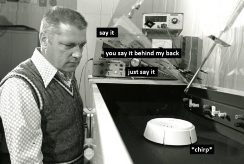
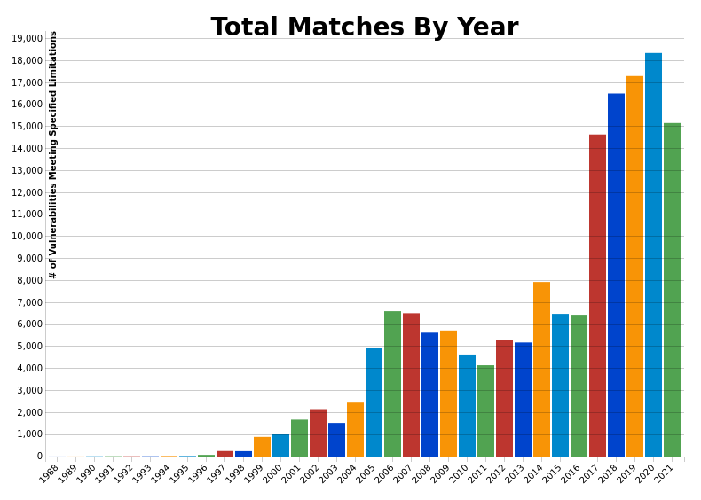
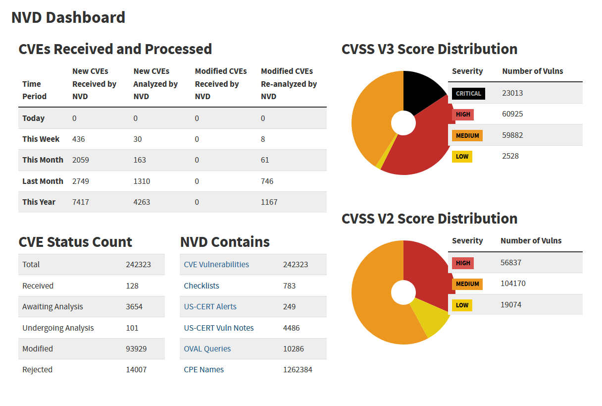

# Vulnerability Taxonomies

Objectives: Understand common vulnerability taxonomies, the standards behind them, and how they relate.

* U.S. National Vulnerability Database ***NVD***
* Common Platform Enumeration ***CPE***
* Common Vulnerabilities and Exposures ***CVE***
* Common Vulnerability Scoring System ***CVSS***
* Common Weakness Enumeration ***CWE***
* Common Attack Pattern Enumeration and Classification ***CAPEC***
* Adversarial Tactics, Techniques & Common Knowledge ***ATT&CK***
* Open Worldwide Application Security Project ***OWASP***

---

# National Institute of Standards and Technology (NIST)

* Founded in 1901
* Standards organization responsible for weights, measurements, and cybersecurity standards
* Also has a solid (if small) [page of memes](https://www.nist.gov/education/memes-nist)



---

# U.S. National Vulnerability Database ***NVD***

* Run by the National Institute of Standards and Technology (NIST)
* Repository of standards-based vulnerability management data
* Includes databases of security checklists, software flaws, misconfigurations, product names, and impact metrics
* NVD takes each CVE and *enriches* it: affected products (CPE), weakness type (CWE), and severity (CVSS)

[nvd.nist.gov](https://nvd.nist.gov/general)

---

# NVD can't keep up

* CVE submissions grew 263% from 2020 to 2025
* April 2026: NIST stopped enriching most CVEs
  * Every CVE is still listed, most are marked "Not Scheduled"
  * Priority goes to CISA KEV entries, software the federal government uses, and "critical software" (OS, browsers, hypervisors, IAM, ...)
  * NVD now uses the CNA's CVSS score instead of scoring it again
* Lesson: a single database is a single point of failure, also check the vendor advisory and [cve.org](https://www.cve.org/)

---

# Common Platform Enumeration ***CPE***

* Basically just an official naming and versioning scheme for IT systems, software, and packages
* Try using it on one of your projects sometime!
* Contains a dictionary of platform names and versions to automate decisions based on known vulnerabilities

[CPE](https://csrc.nist.gov/projects/security-content-automation-protocol/specifications/cpe)

---

# What's in a name?

* Why do we need a common detailed way to name something?
* Well Formed Name (WFN) == attribute-value pair set that can describe a number of products or identify a specific product
* WFN is a logical construct, the CPE is the specific data structure we care about

---

# CPE naming scheme in a nutshell

[From Wikipedia](https://en.wikipedia.org/wiki/Common_Platform_Enumeration)

```
cpe:<cpe_version>:<part>:<vendor>:<product>:<version>:
    <update>:<edition>:<language>:<sw_edition>:
    <target_sw>:<target_hw>:<other>
```

Traditionally, both a blank field or an asterisk `*` refer to a wildcard character.

Some examples:

* `cpe:2.3:o:microsoft:windows_11:-:*:*:*:*:*:*:*` Probably not specific enough for use in this class.
* `cpe:2.3:a:discord:discord:-:*:*:*:*:*:*:*` from [cpe lookup](https://nvd.nist.gov/products/cpe/detail/8F626E63-0694-43F6-8B01-2367BC7D0B71?namingFormat=2.3&orderBy=CPEURI&keyword=cpe%3A2.3%3Aa%3Adiscord&status=FINAL)

---

# Common Vulnerabilities and Exposures ***CVE***

* Reference method for publicly known information security vulnerabilities and exposures
* A CVE ID (`CVE-YYYY-NNNNN`) is a unique identifier for a single vulnerability
* Only CVE Numbering Authorities (CNAs) can assign CVE IDs
  * The CVE Program is run by MITRE and funded by CISA
  * Hundreds of CNAs: vendors (Microsoft, Oracle, Red Hat, etc.), open source projects, and research groups
  * MITRE is the CNA of last resort when no one else covers a product
* Each CVE record contains several specified fields

---

# The CVE Program almost went dark

* April 2025: MITRE's contract to run CVE was about to expire
  * CISA signed an 11-month extension at the last minute
* The scare started backup plans
  * The CVE Foundation, a proposed independent home for CVE
  * The EU Vulnerability Database ([EUVD](https://euvd.enisa.europa.eu/)), run by ENISA
* 2026: CISA made CVE a protected line in its budget

Think about it: should the world's vulnerability naming depend on one government contract?

---

# CVE Further information and search

* [CVE Wikipedia](https://en.wikipedia.org/wiki/Common_Vulnerabilities_and_Exposures)
* [CVE.org Search](https://www.cve.org/) (replaced the old `cve.mitre.org` search)
* [NVD CVE Lookup](https://nvd.nist.gov/vuln/search)

{height=55%}

---

# Common Vulnerability Scoring System ***CVSS***

* Given the growing number of CVEs each year we need a way to focus on the most important ones
* CVSS assigns a numerical score based on the ***severity*** of a given CVE
* Scores range from 0 to 10, low being not very important and 10 being a critical security vulnerability
* Current version is CVSS v4.0 (2023), but v3.1 scores are still everywhere, be sure you are comparing the same versions
* Severity is not risk: a 9.8 on a box nobody can reach may matter less than a 6.5 on your VPN

[CVSS Wikipedia](https://en.wikipedia.org/wiki/Common_Vulnerability_Scoring_System) | [CVSS v4.0](https://www.first.org/cvss/v4-0/)

---

# Know your limits



---

# More Acronyms (YAY! or maybe OMGWTFBBQ)

* **KEV** CISA's Known Exploited Vulnerabilities catalog, CVEs with evidence of exploitation in the wild
  * Federal agencies are *required* to patch KEV entries by a due date (BOD 22-01)
* **EPSS** Exploit Prediction Scoring System, 0 to 1 value with a ton of input (KEV, media, social media, security vendor info, etc.), establishing a *likelihood of exploitation* in the next 30 days
  * Currently on version 4 (2025)

[KEV Catalog](https://www.cisa.gov/known-exploited-vulnerabilities-catalog) | [EPSS model](https://www.first.org/epss/model)

---

# Putting it together: what do I patch first?

1. Inventory what you run (CPE names)
2. Match your inventory to CVEs
3. Is it in KEV? Patch **now**
4. High EPSS? Patch **soon**
5. Use CVSS plus *your* environment to order the rest

Then ask *why* it happened (CWE) so it doesn't happen again.

---

# Common Weakness Enumeration ***CWE***

* Category system for software and hardware weaknesses
* A CVE is a specific bug, a CWE is the *type* of mistake behind it
* Over 950 weaknesses (CWE List v5.0) including
  * Cross-site scripting (CWE-79, #1 in the 2025 Top 25)
  * SQL injection (CWE-89, #2)
  * Path/directory traversal (CWE-22)
  * Hard-coded passwords, insecure random numbers... etc.

[CWE over time](https://nvd.nist.gov/general/visualizations/vulnerability-visualizations/cwe-over-time) | [About CWE](https://cwe.mitre.org/about/index.html) | [CWE Top 25](https://cwe.mitre.org/top25/)

---

# Common Attack Pattern Enumeration and Classification ***CAPEC***

* Public catalog of common attack patterns to help users understand how weaknesses are exploited
* Based on Software Design Patterns
* Relates weaknesses (CWE) and vulnerabilities (CVE)
* Similar to CWE, the same CAPEC may apply to many CVEs
* [CAPEC-139: Relative Path Traversal](https://capec.mitre.org/data/definitions/139.html) attacks CWE-22

[Attack Patterns Wikipedia](https://en.wikipedia.org/wiki/Attack_patterns) | [CAPEC Website](https://capec.mitre.org/about/new_to_capec.html)

---

# Adversarial Tactics, Techniques & Common Knowledge ***ATT&CK***

* Knowledge base of real-world adversary behavior, built from observed attacks
* **Tactics**: the attacker's goal, the *why* (Initial Access, Persistence, Privilege Escalation, Lateral Movement, Exfiltration, Impact, ...)
* **Techniques**: *how* they reach it (`T1566` Phishing, `T1078` Valid Accounts)
* **Groups**: known threat actors (nation-state APTs, ransomware crews) mapped to the techniques they use
* The more you know (or a more theatrical: know your enemy)

[MITRE ATT&CK](https://attack.mitre.org/)

---

# CAPEC & ATT&CK

Use CAPEC for:

* Application threat modeling
* Developer training and education
* Penetration testing

Use ATT&CK for:

* Comparing computer network defense capabilities
* Defending against the Advanced Persistent Threat
* Hunting for new threats
* Enhancing threat intelligence
* Adversary emulation exercises

---

# Open Worldwide Application Security Project ***OWASP***

MITRE is just one (pretty big) organization.  There are others that attempt to classify similar things.

OWASP is a community that attempts similar classification for just web applications.

* Best known for the **OWASP Top 10** (latest is 2025)
* Also maintains Top 10 lists for APIs, mobile, and LLM applications

[OWASP Wikipedia](https://en.wikipedia.org/wiki/OWASP) | [OWASP.org](https://owasp.org/)

---

# OWASP Top 10:2025

1. Broken Access Control
2. Security Misconfiguration
3. Software Supply Chain Failures (new)
4. Cryptographic Failures
5. Injection
6. Insecure Design
7. Authentication Failures
8. Software or Data Integrity Failures
9. Security Logging and Alerting Failures
10. Mishandling of Exceptional Conditions (new)

Think about it: injection is #5 here, but XSS and SQLi are #1 and #2 in the CWE Top 25. Why?

---

# Lab 5: NIST Vulnerability Taxonomies

Everything from today gets used in [Lab 5](https://github.com/mkijowski/lab-nist):

1. **Inventory**: find 5 real CPE names for software on your laptop
2. **CPE**: write a well formed CPE (with a sem-ver version) for code *you* wrote
3. **CWE**: pick a Top 25 weakness that code had, and find real CVEs with it
4. **CVE**: write the CVE for your own bug, CVSS score included (I'm your CNA)

Read before you start:
[CWE Top 25](https://cwe.mitre.org/top25/) | [Top 10 KEV Weaknesses](https://cwe.mitre.org/top25/archive/2025/2025_kev_list.html) | [Semantic Versioning 2.0.0](https://semver.org/)
