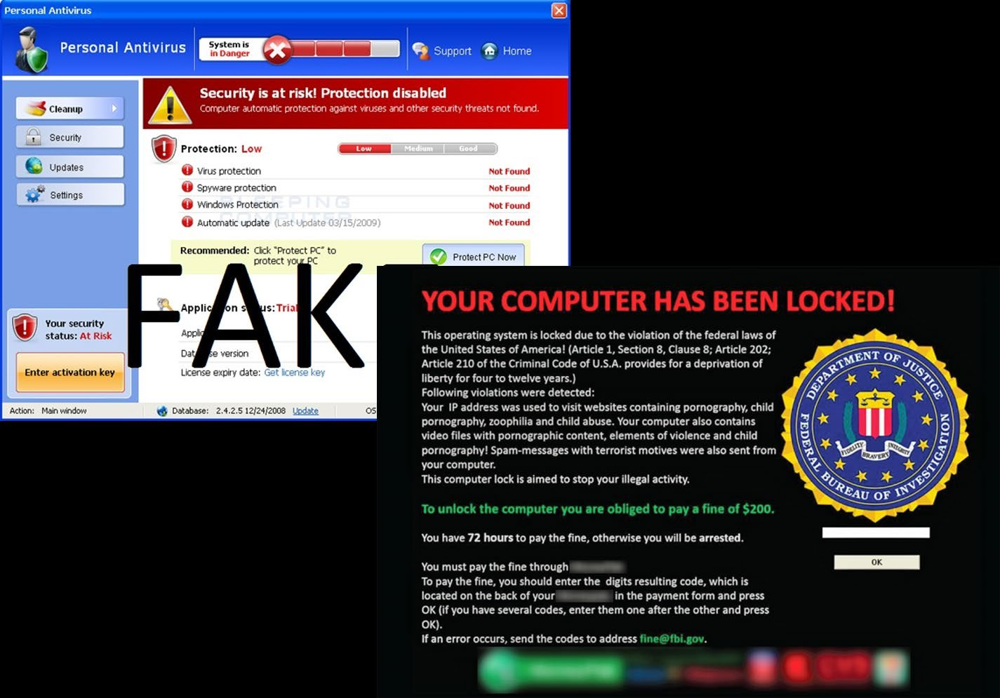
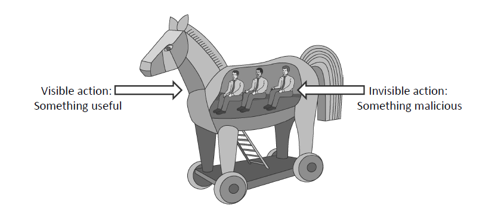
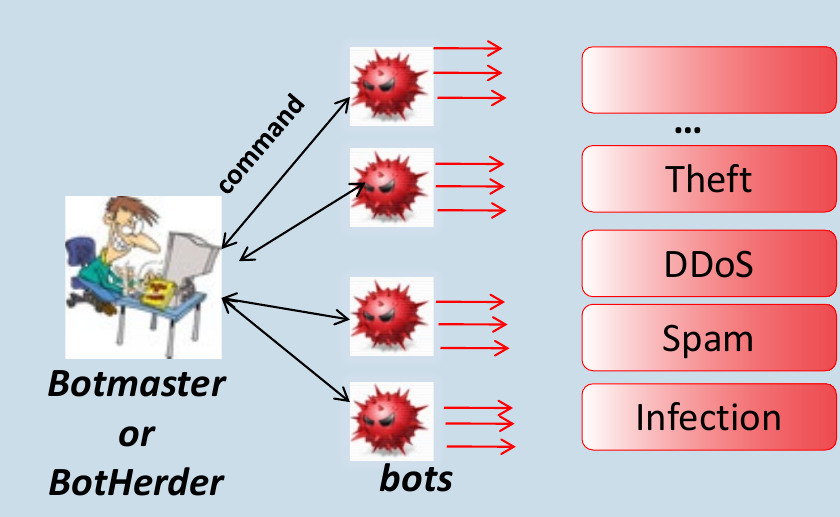
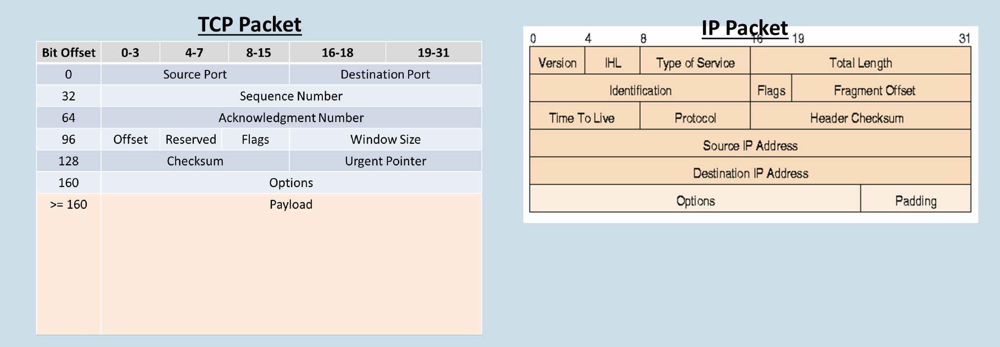

# Malware & Social Engineering

Objectives:

* Define malware
* Overview the various types of malware
* Explain social engineering attacks

---

# Malware: What is it?

***Mal***icious soft***ware***: a general term for hostile or intrusive software

* *Computer Contaminant* is the "legalese" name used in some state legal codes
* Enters a computer system without the owner's knowledge or consent
* Uses a threat vector to deliver a malicious *payload* that performs a harmful function once invoked

What is the important difference between malware and other defective software (bugs)?

***INTENT!***

---

# So many names...

Wide range of names and terms associated with malware, easy to get confused:

* Adware, Backdoor, Bot/Botnet, Dialer, Exploit, Keylogger, Logic Bomb,
  Malicious BHO, Ransomware, Rootkit, Spyware, Trojan, Virus, Worm, Zombie, ...

"Common" types we will cover today:

* Ransomware, Trojan Horse, Rootkit, Virus, Worm
* Bots & Botnets, Phishing, Keyloggers
* Watering Holes, Mobile Malware

---

# Professional Malware

* Growth in professional cybercrime and online fraud has led to demand for professionally developed malware
* New malware is often a custom-designed variation of known exploits
  * The malware designer can sell different "products" to their customers
* Like every product, professional malware is subject to the laws of supply and demand
  * A Remote Access Trojan (RAT): ~$1500 for a lifetime license
  * A zero-day exploit: $80,000 - $300,000

---

# Ransomware

Holds a computer system captive while demanding a ransom

* Encrypts files on the system's hard drive (*cryptoviral extortion*)
* Locks the system and displays messages intended to coerce the user into paying a fee

{height=40%}

---

# Ransomware examples

* **CryptoLocker** (September 2013)
  * Spread through emails that lure victims into opening them
* **PowerLocker** aka Prison Locker (2014)
  * Designed to lock PCs using "uncrackable" crypto
  * Used the `Blowfish` symmetric-key block cipher to encrypt all personal data on a PC
  * Then encrypted those keys using 2048-bit `RSA`

Sound familiar?  This is the same hybrid encryption we covered in the encryption lecture.

---

# Trojan Horse

A program that appears to perform some useful task, but also does something with negative consequences (e.g. launches a keylogger)

{height=22%}

* Can be installed as part of the payload of other malware
* Often installed by a user or administrator, either deliberately or accidentally
* Trojans ***do not*** replicate and ***do not*** infect other files (like viruses and worms do)
* Early Trojans focused on DDoS, now the focus is providing backdoor entry to systems

---

# Remote Access Trojan (RAT)

* Controls a system through a remote network connection
* Often delivered as the payload of a traditional trojan horse
* Tries to hide its operation

---

# Rootkit

Stealth is the primary focus of a rootkit

* Modifies the operating system to hide its existence while gaining remote access or control
  * Installs hacked binaries for system programs such as `netstat`, `ps`, `ls`, `du`, `login`
  * You ***cannot*** detect the attacker's processes, files, or network connections using standard UNIX commands!
* Hard to detect using software that relies on the OS itself
* Focuses heavily on gaining root/administrator privileges
  * Can then alter security software so it is not detected
  * Provides escalated privileges to remote users

---

# Rootkit continued

* Once embedded, activates each time the system boots
  * Activated ***before*** the OS has completely booted
* Can intercept data from terminals, network connections, and keyboards

Remember the file integrity monitoring (tripwire) we talked about in IDS?

---

# Virus

Code that replicates itself by modifying other files or programs to insert code capable of further replication
("attaches itself to an executable file")

Two distinguishing properties:

* replication
* human assistance

Infection Vectors

* **Boot Sector** loaded when the system is booted
* **Executable** (most common) remains inactive on host system until the executable is run
* **Macro files** triggered when a document is loaded

---

# Virus mutation techniques

Mutation engines (Real Permutation Engine/RPME, ADMutate, etc.) have a large arsenal of obfuscation techniques:

* Instructions reordered, branch conditions reversed, different register names, different subroutine order
* Jumps and NOPs inserted in random places
* Garbage opcodes inserted in unreachable code areas
* Instruction sequences replaced with others that have the same effect but different opcodes

```
SUB EAX, EAX      ->  XOR EAX, EAX
MOV EBP, ESP      ->  PUSH ESP; POP EBP
```

The goal is to change enough so there is ***no real signature***, meaning signature based IDS/IPS can't detect it

---

# Worm

Spreads copies of itself without the need to inject itself into other programs, usually without human interaction

* Not considered a virus
* Runs independently, does not require a host program
* Propagates a fully working version of itself to other machines
* Usually carries a malicious payload (deleting files, installing a backdoor, DDoS, etc.)

### VIP

* **Virus** replicates but ***requires*** human assistance
* **Worm** replicates and ***does not*** require human assistance (autonomous)

---

# Worms: early history

The first internet worm was the **Morris Worm**

* Written by Cornell student Robert Tappan Morris
* Released on November 2, 1988
* A 99-line program
* 6000 computers in just a few hours
* Paralyzed the whole Internet at that time
* Was not really "malicious" (propagated without touching data)

The positive impacts

* Raised attention to cyber security
* Computer Emergency Response Team (CERT) was created

---

# Worms that affected the entire Internet

* Morris Worm (1988)
* Code Red (2001)
* Nimda (2001)
* Blaster (2003)
* SQL Slammer (2003)

---

# Bots & Botnets

**Bot**: software created to automatically perform specific operations

* Some bots are benign (video games, internet auctions, online contests, etc.)
* Many bots used today are malicious
* Note: the textbook refers to bots as *Zombies*

**Botnet**: a collection of bot-compromised hosts coordinated via a
*command and control* (C&C or C2) channel by an attacker

---

# Botnet

{height=60%}

---

# Phishing

Uses social engineering techniques to fraudulently acquire personal information

* Masquerades as a trustworthy person or business in an official looking electronic communication
* Emails or instant messages claiming to come from banks, payment processors, or IT admins
* Risk has grown exponentially with the advent of social media
* Fake websites that almost identically mirror the legitimate domain

---

# Spear Phishing and friends

**Spear phishing**: a more sophisticated, targeted form of phishing

* Select groups or individuals are targeted
* Intent is to harvest very specific information or infect very specific entities
* Emails crafted to appear to be from a legitimate source

**Whaling**: going after the "big fish" (wealthy individuals, executives)

**Vishing** (voice phishing)

* Attacker calls victim with a recorded "bank" message and callback number
* Victim calls the attacker's number and enters private information

Given the importance of the user here, defenses focus on ***user training and public awareness***

---

# Keylogger

Used to intercept passwords and other confidential info entered via keyboard

* Present no threat to the system itself
* Implemented via video surveillance, hardware bugs, malicious keyboard drivers, intercepted kernel functions, etc.

Example: Heartbleed scareware (2014)

* Users receive email: "you were infected by heartbleed, install the attached file"
* Encrypted zip file, once extracted users ran `heartbleedbugremovaltool.exe`
* Keylogger installed, recorded keystrokes, took screenshots, sent them to a free hosted email account

---

# Watering Holes

Not a form of malware in their own right, a means of delivering it

* AKA *strategic web compromises*
* Goal is ***not*** to spread malware to as many systems as possible
* Goal is to run exploits on trusted sites likely to be visited by the attacker's targets
* Relying on known and trusted sites makes this an extremely efficient attack vector
* Common exploits: SQL injection, malicious iFrames, cross-site scripting (XSS)

---

# Watering Hole example

The VOHO Campaign (2012)

* Focused on US financial and high tech
* Malicious JavaScript inserted in websites
* Arriving at the site caused installation of `gh0st RAT` (Remote Access Trojan)
* 32,000 individual hosts across 4000 organizations

---

# Mobile Malware

* Not new, worms first attacked Symbian Series 60 phones as far back as 2004
* Rapid expansion in number, variety, and sophistication
* One of the most common variants is the SMS-sender (e.g. `Andr/AdSMS`)
  * Malicious application disguised as a pirated app
  * Hidden module starts sending SMS messages to premium rate numbers
  * People don't check their mobile bills, so it takes time to be noticed

---

# Notable Mentions: Zero Day

An unknown security vulnerability

* One the "good guys" have not discovered or have not had time to patch
* Good guys share info about new exploits/vulnerabilities
  * sometimes privately with just the owners, sometimes world wide
* Fixes are developed and distributed
* When "bad guys" discover a new vulnerability first, a potential zero day exists
  * The "game" is how long a zero day stays a zero day

Impossible to defend against directly: you can't defend against something you don't know about

---

# Notable Mentions: Covert Channel

Sends and receives information between machines without alerting firewalls or IDS

* Sends traffic through ports most firewalls will permit
* Bypasses an IDS by appearing to be an innocuous packet
* Conceals data in one of the control fields of the TCP or IP headers

{height=45%}

---

# Social Engineering

### "The Art of Human Hacking"

---

# What is Social Engineering

* Manipulating a person into knowingly or unknowingly giving up information
  * Psychological manipulation
  * Trickery or deception for the purpose of information gathering
* A way for criminals to gain access to information systems
  * Secretly install spyware or other malware
  * Trick people into handing over passwords or other sensitive information
* One of the most effective routes to stealing confidential data from organizations
  * In a Siemens test, 85 percent of office workers were duped

---

# Kevin Mitnick

> "You could spend a fortune purchasing technology and services from every exhibitor, speaker and sponsor at the RSA Conference, and your network infrastructure could still remain vulnerable to old-fashioned manipulation."

---

# Real Examples

* **Security Pacific National Bank** (1978)
  * Stanley Mark Rifkin stole $10,200,000 in a single social engineering attack
* **RSA**
  * Infected Excel attachment, over $100 million in damage
* **Wells Fargo Bank**
  * "Catholic Healthcare" phone call, $2.1 million vanished
* **Vodafone Help Desk**
  * Malware and fraud call, end user lost everything

---

# What are they looking for?

Simple information: your pet's name, where you're from, places you've visited.
Information you would freely give your friends.

Think of yourself as a walking computer full of valuable information:

* Personally identifiable data, financial info, cardholder data, health insurance data, credit data, ...

Look at the "secret questions" on sites you log into:

* What's the name of your first pet?
* What is your mother's maiden name?
* When was your mother/father born?
* Where were you born?

Do these sound familiar?

---

# Tactics

* Pretexting & fake scenarios
* Phishing/Spear Phishing
* Fake websites
* Fake pop-ups
* Impersonation on help desk calls
* Physical access (tailgating)
* Shoulder surfing
* Dumpster diving
* Stealing important documents
* Fake software
* Trojans

REMEMBER: Social Engineering == The Art of Human Hacking

---

# Protecting Yourself

A security aware culture helps employees identify and repel social engineering attacks

* Recognize inappropriate requests for information
* Take ownership of corporate security
* Understand the risk and impact of security breaches
* Social engineering attacks are personal
* Password management
* Two factor authentication
* Physical security
* Understand what you put on the web (social networks are a targeting goldmine)

---

# Protecting your organization

* Network defenses
  * Anti-virus / endpoint protection
  * Email attachment scanning
  * Firewalls, etc.
* Organizations must decide what information is sensitive
* Security must be periodically tested
* Contact your security office immediately if you have any concerns at work

---

# Responding

You've been attacked, now what?

* Have a place to report incidents
* People need to take responsibility
* Conduct audits
* What damage has been done? What damage can still be done?
* Has a crime actually taken place?

---

# Summary

* Malware is malicious software that enters a system without the owner's knowledge or consent
  * Malware that spreads: viruses, worms, and Trojans
* Spyware secretly collects information without the user's consent
  * keyloggers, adware, ransomware
* A very popular payload: placing the infected computer under remote control (a bot or zombie)
* Social engineering is "hacking into" individuals
  * phishing, dumpster diving, tailgating, and much more than just flavors of phishing
* Protecting against social engineering is the same as protecting against other attacks

---

# Class Exercise: Phishing Tests

Table group exercise

* Hook 1 laptop at each table to the projection system
* Work as a team, all other table members collaborate and discuss
* Document reasoning for each answer (on the white board if possible)

Exercises:

* [Exercise #1: SonicWall Phishing IQ Test](https://www.sonicwall.com/en-us/phishing-iq-test)
* [Exercise #2: OpenDNS Phishing Quiz](https://www.opendns.com/phishing-quiz/)

---

# Sources

* Security+ Guide to Network Security Fundamentals, 5th Edition, Mark Ciampa
* Other WSU CyberSecurity lectures
* CERT-UK, *An introduction to malware*, 2014
* McAfee Labs Threat Report 2015
* [CS 426 Lectures, Purdue University](http://www.cs.purdue.edu/homes/ninghui/courses/426_Fall10/handouts/426_Fall10_lect11.pdf)
* [Wikipedia Malware](https://en.wikipedia.org/wiki/Malware)
* [Wikipedia Social Engineering](https://en.wikipedia.org/wiki/Social_engineering_(security))

