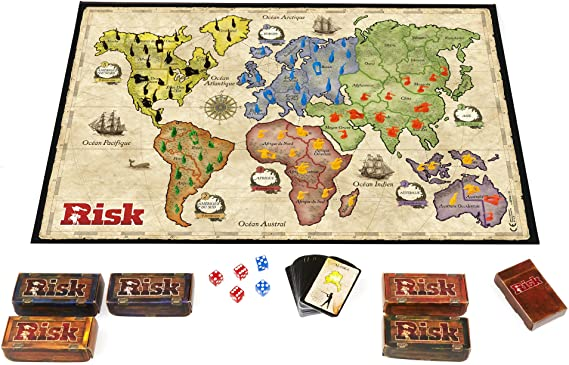
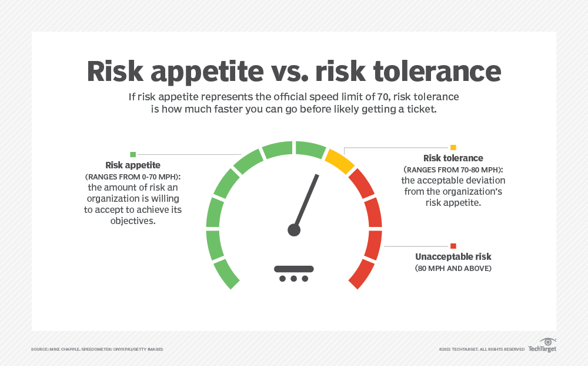
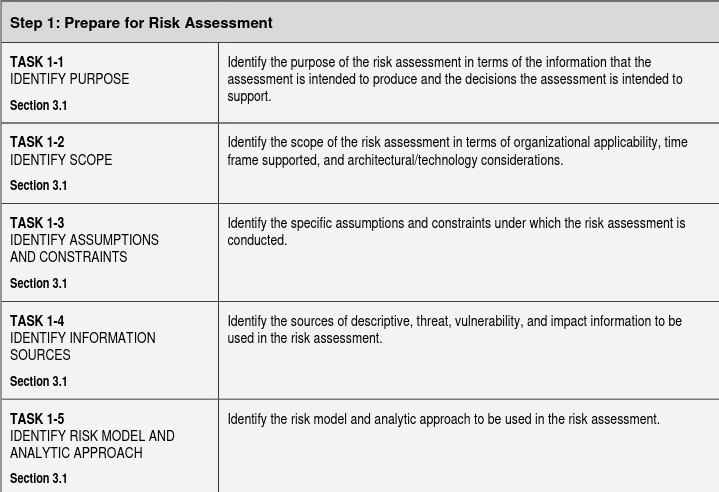
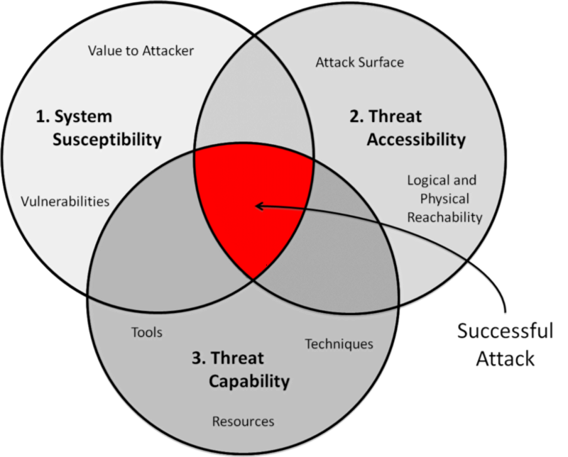
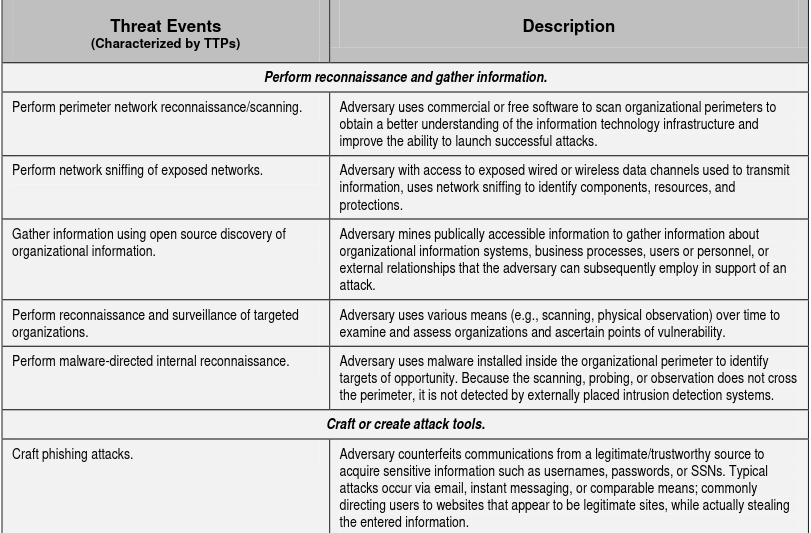
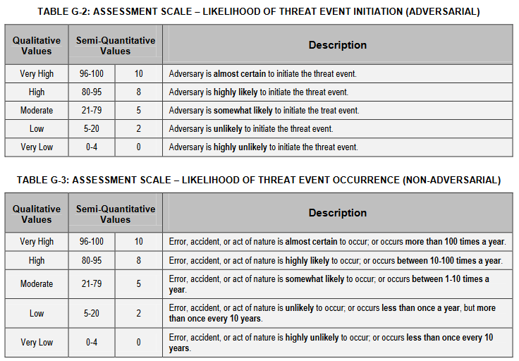
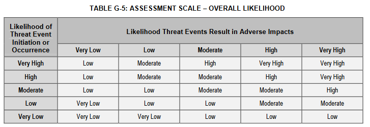

# CEG 3400 : Risk

\*Not the board game

---

# Risk

Today we are going to cover the following:

* Risk Profile
  * Risk Appetite
  * Risk Tolerance
  * Risk Capacity
* Risk Management
* Threat Modeling
* Risk Assessment tools
* Risk Response (what do we *do* about it?)

---

# What is Risk?

{height=40%}

*noun* a situation involving exposure to danger.

*verb* to expose to danger, harm, or loss.

---

# Risk Profile

* **Risk Appetite**: the risk *NEEDED* to achieve your goals
* **Risk Tolerance**: how comfortable you feel about a risk, AKA the risk you *PREFER* to take
* **Risk Capacity**: the risk you can *AFFORD* to take

{height=80%}

---

# Let's practice

NIST Special Publication 800-30 Rev. 1: Guide for Conducting Risk Assessments

Lab 6 is all about risk assessment.

---

{height=80%}

---

# Lab 6

* You alone are the entire C-suite of a new startup, ***Your Name Inc.***

* The business purpose of this startup is to help you graduate and
  get an awesome job while maintaining some semblance of sanity (this is a joke,
  stay healthy kids).

* Insiders in your organization are anyone currently living with you or
  sharing an account with you.

* Purpose of this assessment: familiarize the board of ***Your Name Inc.***
  with basic risk assessment practices and identify any high-risk items that
  might impede your organization's objectives.

---

# Risk Management

Understand, analyze, and address risk to make sure the organization achieves its goals.

* It is a continuing process (it repeats)
* Before you can understand your risks, you need to identify them
* Your entire organization will get this wrong (everyone does)
* Your organization will do this better than some multi-million-dollar companies (see the last point)
* Humans (and Mark Zuckerberg) perform risk management every day

Case in point: ***Mat Honan***

---

# Mat Honan (2012)

* Wired writer (formerly at Gizmodo)
* Twitter nerd with a rare 3-letter handle: `@mat`
* Apple fanboy
* Used Apple's `me.com` (iCloud)
* Gmail user
* Also bought items on `amazon.com`

---

# The Hack

::: columns

:::: column

{height=15%}

::::

:::: {.column width=15%}

{height=5%}

::::

:::: column

{height=15%}

::::

:::

---

# The Hack, as a risk assessment

* **Asset of value**: the attackers only wanted `@mat`, everything else was collateral damage
* **Accessibility**: Twitter → personal site → Gmail recovery page leaked a `me.com` address
* **Capability**: social engineering Amazon support for the last 4 digits of a card,
  then AppleCare for an iCloud password reset (human factors!)
* **Impact**: Find My iPhone/Mac wiped his phone, iPad, and laptop.
  No current backup, so years of family photos were at risk

One cheap control (backups) would have turned a catastrophe into an inconvenience.

---

# Lab 6: Scope

* `nmap` scan of your home network (with permission)
* All other networked and non-networked electronic devices
* All online accounts with non-directory information
* All pertinent data about you that might cause harm
* Time frame is from today until after your first month at a CS/Cyber/IT job

---

# What are we doing?

* Policies: Confidentiality, Integrity, Availability
* Threat Model: assumptions about our adversaries
* Mechanisms (SW, HW, procedures, etc.) that achieve org goals and maintain our policies

---

# But you did not have the word risk in that last slide...

Before we can assess risk, we need to understand the threats we may be facing.

There are 2 types of threats we are going to focus on:

* Non-adversarial
* Adversarial

---

# Non-adversarial

* Accident
* Human error
* Structural failure
* Environmental

See NIST 800-30 Table E-3.

---

# Adversarial

Deliberate actions of a third party with ***intent*** to cause organizational
disruption or loss.

Who are our adversaries and what are their capabilities?

* Hackers
* Script kiddies
* Cyber criminals
* Cyber terrorists
* Hacktivists
* State-sponsored attackers
* That one cousin who can't stand to see you succeed and is actively sabotaging your graduation
* That one person from ITinder you swiped right on, had dinner with, then ghosted

---

# From Day 1:

{height=50%}

---

# 1. System Susceptibility

Is the system able to be attacked?

Questions to ask:

* Does it have value to attackers?
* That's about it...

Mitigations:

* Inventory (for CVE tracking by CPE, and to assign value)
* CVEs
* Good IT and coding standards / practices

---

# 2. Threat Accessibility

Questions to ask:

* What is your attack surface?
* What is the logical and physical reachability?

Mitigations:

* Inventory (to better describe your attack surface)
* Physical security (prevent physical access)
* Network architecture and firewalls (prevent logical access)
* User accounts with good authentication (multifactor)

---

# 3. Threat Capability

* For each threat source, do they have the necessary tools / techniques / resources to attack *a given vulnerability*
  that they *have access to*?

Assumptions:

1. A vulnerability exists
2. That vulnerability is accessible

Mitigations:

* Remove access
* Patch or remove vulnerabilities
* Understand what your adversaries are capable of (ATT&CK, threat modeling)

---

# What can our adversaries do?

NIST 800-30 Table E-2

---

# Where are we weakest?

Identify all vulnerabilities and predisposing conditions that affect the
likelihood of a threat event causing adverse impact.

---

# Determine Likelihood

What are the chances of a threat event occurring that results in adverse impact?

Consider the following:

* Characteristics of the threat source
* Vulnerabilities identified
* Susceptibility, given the safeguards/countermeasures the org has in place
  to prevent or impede such an event

---

# Likelihood continued

---

# Overall Likelihood

---

# Determine impact of event

Assuming the event occurs, what is the impact of that event?

* Think in terms of what you lose: confidentiality, integrity, or availability
* Harm to operations, assets, individuals, other organizations (and your GPA)
* Lab 6 uses the 0-10 scale from NIST 800-30 Table H-3

---

# Determine Risk

Based on the likelihood of an event occurring and the impact of that event
should it occur.

* Lab 6 uses NIST 800-30 Table I-2 to combine the two
* High likelihood + low impact: annoying, manage it
* Low likelihood + high impact: *this* is where people get burned (see Mat Honan)

---

# Qualitative vs. Quantitative

***Qualitative / semi-quantitative*** (NIST 800-30, Lab 6)

* Low / Moderate / High, or a 0-10 scale
* Fast and easy to explain, but subjective

***Quantitative***

* Annualized Loss Expectancy: `ALE = SLE × ARO`
* Laptop worth $1,500, stolen about once every 5 years: `ALE = $1,500 × 0.2 = $300/yr`
* Do not spend $500/yr protecting a $300/yr risk

---

# Risk Response

Once you have a ranked list, you have four choices for each risk:

* **Mitigate**: add a control to lower likelihood or impact (MFA, backups, patching)
* **Transfer**: make it someone else's problem (cyber insurance, warranties, cloud provider SLAs)
* **Avoid**: stop doing the risky thing (delete the old account, unplug the IoT camera)
* **Accept**: document it and move on, it is within your tolerance

Accepted risk is still risk, so have an incident response plan for when it happens
(remember the IR plan from the authentication lecture).

---

# Why is this hard?

* Scores are subjective: two analysts, two different answers
* You cannot protect what you do not know you have (incomplete inventory, shadow IT)
* Humans are bad at probability: we overrate dramatic threats and underrate boring ones (disk failure!)
* Threats change faster than assessments get redone
* Your risk depends on other people's security (Amazon and Apple support for Mat Honan, vendors, supply chain)
* Measuring risk costs time and money too

---

# Where does 800-30 fit?

* **NIST CSF 2.0** (Feb 2024): Govern, Identify, Protect, Detect, Respond, Recover
  * *Govern* is new: risk strategy, appetite/tolerance, and supply chain risk are now board-level concerns
  * No longer just for critical infrastructure: aimed at every organization
* **NIST SP 800-30 Rev. 1** (2012): still the current guide for *how* to conduct the assessment
* Lab 6 is your first pass at the *Identify* function for ***Your Name Inc.***

---

# What do we get out of all this?

*Hopefully* two things:

1. A better understanding of your overall risk profile, which can inform
   decisions about better mechanisms to protect the organization.
2. A priority ranking of threats as they would impact your organization.
   Given limited resources, this focuses your organization's spending
   on security mechanisms with a higher Return On Investment.

Then do it again next year (risk management repeats!).

---
