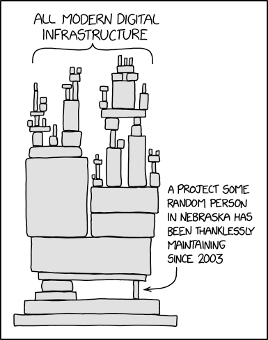

# CEG 3400 : The NICE Framework

\*Not a compliment

---

# NICE Framework

Today we are going to cover the following:

* What is the NICE Framework?
* How it is built
  * Work Role Categories
  * Work Roles
  * Competency Areas
  * Task, Knowledge, and Skill (TKS) statements
* What changed recently
* How it connects to risk

---

# What is the NICE Framework?

***Workforce Framework for Cybersecurity***, NIST SP 800-181 Rev. 1

* NICE = National Initiative for Cybersecurity Education
* A common language for describing cybersecurity ***work*** and the
  ***people*** who do it
* Used by employers (job postings), educators (courses like this one),
  certification bodies, and you (career planning)

CSF and 800-30 tell us *what* to protect and *how* to assess it.

NICE tells us ***who*** does that work and what they need to know.

---

# How it is built

Two layers:

1. **The publication** (SP 800-181r1): the concepts, rarely changes
2. **The Components**: the actual content, versioned like software
   (`v2.0.0`, `v2.1.0`, `v2.2.0`) and published as a spreadsheet and `JSON`

---

# The Components

From broadest to most specific:

* **Work Role Categories** (7 of them)
* **Work Roles**: groupings of work, ***not*** job titles (e.g. `IN-WRL-001`)
* **Competency Areas**: cross-cutting domains (AI Security, Cryptography)
* **TKS statements**: the atoms
  * **Task**: the work being done
  * **Knowledge**: what you need to know
  * **Skill**: what you need to be able to do

---

# Work Role Categories

| Code | Category                  |
|------|---------------------------|
| `OG` | Oversight & Governance    |
| `DD` | Design & Development      |
| `IO` | Implementation & Operation|
| `PD` | Protection & Defense      |
| `IN` | Investigation             |
| `CI` | Cyberspace Intelligence   |
| `CE` | Cyberspace Effects        |

Most real jobs are a blend of several Work Roles, often across categories.

---

# What changed recently?

* **v2.0.0** (March 2025): major revision, breaks backward compatibility
  * TKS statements largely rewritten with new IDs
  * New Work Role: OT Cybersecurity Engineering (`DD-WRL-009`)
* **v2.1.0** (Dec 2025): Cybercrime Investigation (`IN-WRL-001`) overhauled,
  AI Security Competency Area updated
* **v2.2.0** (April 2026): new Cybersecurity Supply Chain Risk Management
  Work Role (`OG-WRL-017`), Cryptography Competency Area

If you find an old chart online with 52 roles and categories like
*Securely Provision* or *Analyze*, that is the 2017 model. Also gone:
*Ability* statements (it used to be KSA, now it is TKS).

---

# Risk management needs people

Last week: identify, assess, and respond to risk.

Somebody actually has to *do* all of that.

* Oversight & Governance (`OG`) is where most risk work lives
  * Security and risk management, policy, executive leadership
* Every risk response maps to someone's Tasks
  * **Mitigate**: `IO` and `PD` roles deploy and run the controls
  * **Transfer**: `OG` roles negotiate contracts, insurance, and SLAs
  * **Accept**: `OG` roles document it and own the decision
* Lab 6: you were the *entire* C-suite of ***Your Name Inc.***,
  which means you held a lot of Work Roles at once

---

# NICE + NIST CSF 2.0

* **CSF 2.0**: the *outcomes* an organization wants
  (Govern, Identify, Protect, Detect, Respond, Recover)
* **NICE**: the *workforce* that achieves those outcomes
* NIST publishes an official crosswalk between the two
* **SP 1308** (draft): Cybersecurity, Enterprise Risk Management, and
  Workforce Management Quick-Start Guide, which ties all three together

Think of it this way:

* CSF says "we need to *Detect* anomalies"
* NICE says "that is a Defensive Cybersecurity Work Role, and here are
  the TKS statements for the person you need to hire"

---

# Supply chain risk got a job title

Remember Mat Honan? His risk depended on ***Amazon*** and ***Apple*** support.

* CSF 2.0 moved supply chain risk into *Govern* (board-level concern)
* NICE `v2.2.0` added a matching Work Role:
  ***Cybersecurity Supply Chain Risk Management*** (`OG-WRL-017`)
* Vendors, cloud providers, open source libraries, and hardware are all
  part of your attack surface, and now someone is explicitly responsible

A risk topic got important enough to become a named job.

---

# Your supply chain, visualized

{height=75%}

Vendors, cloud providers, open source libraries:
someone in Nebraska is part of your attack surface.

---

# The skills gap is a risk

Run it through our own risk model:

* **Vulnerability**: nobody on staff has the TKS for a critical Work Role
* **Threat**: anything that role was supposed to catch
* **Likelihood**: goes up when the role is empty, overloaded, or half-trained
* **Impact**: whatever that role was protecting

Risk responses still apply:

* **Mitigate**: train or hire
* **Transfer**: outsource (MSSP, consultants)
* **Accept**: document it... and hope

Question for you: which Work Roles is ***Your Name Inc.*** missing?

---
