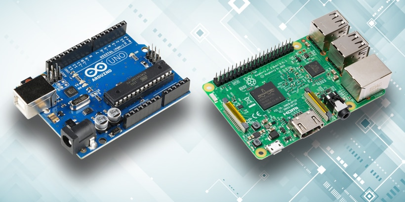
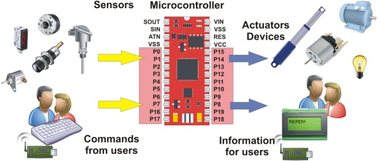
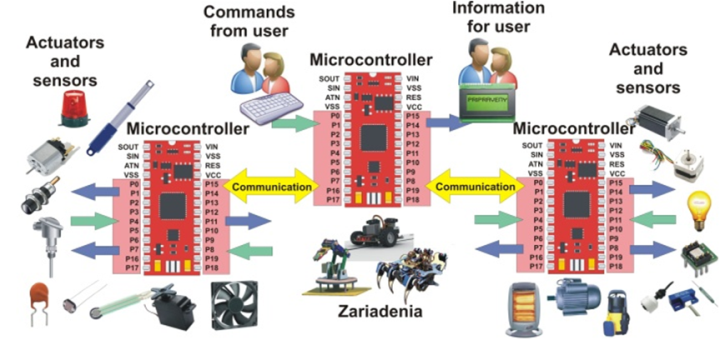

# CEG 3400 : Internet of Things

\*The "S" in IoT stands for Security

---

# IoT

Today we are going to cover the following:

* Embedded systems
* Internet of Things (IoT)
* Non TCP/IP wireless
* IoT security challenges
* IoT in critical infrastructure (OT/ICS)
* Real attacks and the actors behind them
* Incident response: when a device is already compromised
* Standards, labels, and laws (it moved a lot recently)
* A defense plan for your own devices

---

# Where we are

* **Risk** (NIST 800-30, Lab 6): you inventoried every device on your home network
* **CMMC**: prove you protect the data you are trusted with
* **IoT**: the devices you found in that `nmap` scan that you ***cannot*** patch, configure, or even log into

Remember the Risk Response slide?

***Avoid***: unplug the IoT camera

Today is about why that was on the list.

---

# Embedded systems

> Computing hardware and software contained within a larger system
  (typically designed for a specific function)

* **They're everywhere!** (they being computers)
* Examples:
  * Medical devices
  * Vehicles (aircraft, cars, etc.)
  * Industrial machines and fabrication
  * Heating, ventilation, and air conditioning (HVAC)
  * "Smart" home (lights, dishwashers, etc.)
  * Sensors/alarms/security
  * etc.

---

---

# Common traits of embedded systems

::: columns

:::: column

* Autonomous
* Cloud controlled
* Dynamic: functional requirements may change over time
* Networks of (often duplicate) devices
* Cascading failures
* AI/ML (Artificial Intelligence / Machine Learning)
* Multiple sensors and actuators
* Privacy and safety concerns!!!

::::

:::: column

::::

:::

---

# Embedded systems security issues

* Requires different security techniques from standard desktop computing
  * Cost sensitive (cheaper devices make more sense in large quantities)
  * Energy constraints (batteries)
  * Computing constraints (low processor power, often no room for AV or full TLS stacks)

* Potential threat events similar to desktop computing
  * Interception / eavesdropping
  * Fault generation / denial of service
  * Fabrication / forgeries

* Software + Hardware security!

---

# Hardware security

The attacker can often hold the device in their hand.

* **Debug ports** (UART, JTAG) left on the board: often a root shell, no password
* **Firmware extraction**: read the flash chip, then hunt for hard-coded keys and passwords
* **Side channels**: power draw and timing can leak crypto keys
* **Fault injection**: glitch the voltage or clock to skip a check

Defenses:

* Secure boot: only run firmware with a valid ***digital signature*** (keys lecture)
* Signed updates (same idea, applied to every patch)
* Hardware root of trust / secure element to hold keys
* Disable debug interfaces before shipping

---

# Internet of Things (IoT)

> The Internet of things (IoT) describes physical objects (or groups of such objects) that are embedded with sensors, processing ability, software, and other technologies that connect and exchange data with other devices and systems over the Internet or other communications networks. *-Wikipedia*

{height=50%}

---

# Interconnected

Ranges are rough, typical numbers (power, antennas, and obstacles change everything).

### Short-range wireless
* Wi-Fi (TCP/IP over radio frequencies) *~100 meters*
* Li-Fi (TCP/IP over infrared/visible light) *~10 meters*
* Near-field communications (NFC) *~4 centimeters*
* Bluetooth / Bluetooth Low Energy (BLE) *~10-100 meters*
* RFID *~centimeters (passive) to ~100 meters (active)*
* Zigbee *~10-100 meters (mesh)*
* Z-Wave *~30-100 meters (mesh)*

---

# Interconnected (continued)

### Medium-range wireless
* LTE *~10 kilometers*
* 5G *~1 kilometer* (much less for mmWave, much more for low-band)

### Long-range wireless
* Low-power wide-area networking (LPWAN, e.g. LoRaWAN) *~2-15+ kilometers*
* Very small aperture terminal (VSAT): satellite links, the satellite itself
  may be ~36,000 kilometers up
* Deep Space Network (DSN) *~millions to billions of kilometers*

---

# Smart home protocols today

* **Thread**: low-power IPv6 mesh network (same IEEE 802.15.4 radio as Zigbee)
* **Matter**: an application standard that runs over Wi-Fi, Thread, and Ethernet
  * Backed by Apple, Google, Amazon, Samsung (Connectivity Standards Alliance)
  * Every device has a certificate (device attestation, PKI like TLS) and encrypted local control
* Zigbee and Z-Wave devices still need a ***hub*** to translate to IP

Why do we care?

* Protocol choice decides what an attacker needs: radio range, a hub, or just the Internet
* "Non TCP/IP" does not mean "not reachable": the hub or bridge *is* on your network

---

# IoT security

* Hardware
  * Remote, physically accessible, and vulnerable
* Software
  * Updates (if they exist at all)
  * Default credentials
  * ***in***security by obscurity
  * Support ends long before the device stops working
* Data
  * Where does it go? (vendor cloud, third parties)
  * Eavesdropping
* Safety
  * IoT devices frequently control something physical
* Interconnectedness
  * Weakest link (IoT devices can be controlled by other devices)

---

# IoT in critical infrastructure

Power, water, pipelines, manufacturing, hospitals all run on embedded controllers.

***Operational Technology (OT)*** and ***Industrial Control Systems (ICS)***

* PLCs (programmable logic controllers), SCADA, sensors, valves, pumps
* Designed for isolated networks, now connected for remote monitoring
* Lifespans of 20-30 years (patching means downtime)
* Old protocols (Modbus, original DNP3) have ***no*** authentication: any message is trusted

---

# IT vs. OT priorities

| | IT | OT |
|---|---|---|
| Top priority | Confidentiality | Availability and ***safety*** |
| Patch cycle | Monthly | Years, if ever |
| Reboot to fix? | Sure | Shut down the plant? |
| Failure means | Data breach | Physical damage, injury |

Integrating IT and OT is the challenge: one network, two very different sets of rules.

---

# Attacks: Mirai (2016)

* Malware that scanned the Internet for IoT devices (cameras, DVRs, routers)
* Logged in with about 60 ***default username/password*** pairs
* Self-spreading (worm behavior): a botnet of hundreds of thousands of devices
* Oct 2016 DDoS on DNS provider Dyn knocked Twitter, Netflix, Reddit, and GitHub offline
  for much of the US East Coast

Who did it?

* Three college-age men, to attack rival Minecraft servers (and sell DDoS protection)
* Source code posted online weeks ***before*** Dyn: anyone could run it (and still does)

The fix was a password change.

---

# Attacks: Volt Typhoon (2023-present)

* People's Republic of China ***state-sponsored*** actor
* Hijacked hundreds of US ***end-of-life*** SOHO routers (mostly Cisco and Netgear) into the "KV Botnet"
* Used them to hide traffic while getting into US critical infrastructure (communications, energy, water)
* Goal per CISA: pre-position to disrupt infrastructure in a future conflict
* Dec 2023 (announced Jan 2024): FBI, under court order, remotely removed the malware

Routers nobody patched became a weapon of a nation-state.

---

# Attacks: who and why

| Actor | Example | Motivation |
|---|---|---|
| Criminals | Mirai | Money (DDoS-for-hire) |
| Nation-state | Volt Typhoon | Espionage, sabotage |
| State-backed "hacktivists" | CyberAv3ngers (2023) | Politics, disruption |
| Researchers | 2015 Jeep hack | Force a fix |
| Insiders | Angry employee | Revenge, money |

CyberAv3ngers (Iran-linked) defaced PLCs at US water utilities in 2023, using the default password.

Same categories as the network attacks lecture: botnets, DoS, unauthorized access.

---

# That last slide was kinda rough right?

MITRE's ***EMB3D*** threat model for embedded devices

* Draft Dec 2023, full release with mitigations Oct 2024, now at version 2.0.x
* Like ATT&CK and CWE, but for embedded devices
* Maps device ***properties*** (has a debug port, runs Linux, etc.) to ***threats*** to ***mitigations***
* Mitigations are tiered: Foundational, Intermediate, Leading
* Aimed at device designers, but also works as a pen-test / defense checklist

[emb3d.mitre.org](https://emb3d.mitre.org/)

---

# Standards and laws

* **NIST IR 8259A**: baseline IoT device capabilities (identity, config, data protection, updates)
* **ETSI EN 303 645**: consumer IoT baseline, the basis for the UK's PSTI law (2024)
  * No universal default passwords
  * Published vulnerability disclosure policy
  * Stated security update period
* **ISA/IEC 62443**: the standard for industrial control systems
* **MITRE EMB3D**: threat model (previous slide)

---

# Labels and laws (still moving)

* **U.S. Cyber Trust Mark** (FCC): voluntary label for consumer IoT, "Energy Star for security"
  * Based on NIST criteria, includes a QR code to a registry (support end date, update method)
  * New lead administrator (ioXt Alliance) April 2026; no labeled products yet, goal is 2027
* **EU Cyber Resilience Act**: ***mandatory*** for products with digital elements sold in the EU
  * Since Sept 11, 2026: manufacturers must report actively exploited vulnerabilities within 24 hours
  * Full requirements apply Dec 11, 2027
  * Fines up to EUR 15 million or 2.5% of global turnover

The shift: from "buyer beware" to "manufacturer is responsible."
Compliance frameworks put the cost of insecurity on the people who can fix it.

---

# A defense plan for your IoT

1. **Inventory**: you already did this (Lab 6 `nmap` scan)
2. **Change default credentials**, turn on MFA for the vendor account
3. **Segment**: IoT on its own guest/IoT network, so a hacked bulb cannot reach your laptop (firewalls!)
4. **Update**: turn on auto-update, check the support end date ***before*** you buy
5. **Reduce attack surface**: disable UPnP and remote access you do not use
6. **Monitor**: watch for unexpected outbound traffic (IDS, router logs)
7. **Replace** end-of-life devices (Volt Typhoon's favorite)
8. **Avoid**: does the toaster need Wi-Fi?

---

# Incident response: your camera joined a botnet

Same lifecycle as the authentication and IDS lectures, applied to a device you cannot log into:

* **Detect**: IDS alert or router logs show the camera scanning the Internet
* **Contain**: move it to an isolated network, or block it at the firewall
* **Eradicate**: reboot clears Mirai (it lives in memory), then factory reset and reflash signed firmware
* **Recover**: change the password ***before*** reconnecting, or it is reinfected within minutes
* **Lessons learned**: update the inventory and risk register; replace it if the vendor stopped patching

---

# Takeaways

* Embedded and IoT devices are computers with ***fewer*** defenses and ***more*** physical consequences
* Hardware attacks matter when the attacker can touch the device
* Critical infrastructure runs on this stuff, and OT puts availability and safety first
* Real attacks range from teenagers (Mirai) to nation-states (Volt Typhoon), usually through default passwords and unpatched devices
* Standards (EMB3D, ETSI EN 303 645, 62443) and laws (Cyber Trust Mark, EU CRA) are catching up
* Have a plan before a device is compromised: segment, monitor, and know how to respond

---

# Further Reading

* [MITRE EMB3D](https://emb3d.mitre.org/)
* [NIST IR 8259A: IoT Device Cybersecurity Capability Core Baseline](https://csrc.nist.gov/pubs/ir/8259/a/final)
* [CISA: Volt Typhoon advisory (AA24-038A)](https://www.cisa.gov/news-events/cybersecurity-advisories/aa24-038a)
* [FCC: U.S. Cyber Trust Mark](https://www.fcc.gov/cybertrustmark)
* [EU Cyber Resilience Act](https://digital-strategy.ec.europa.eu/en/policies/cyber-resilience-act)
