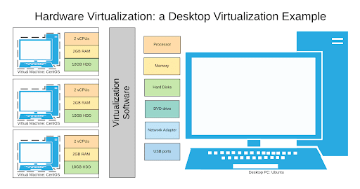
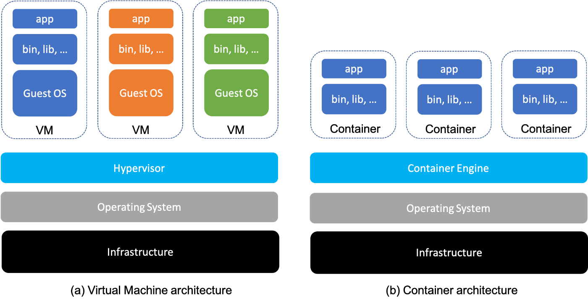

# CEG 3400 : Virtualization and Cloud

\*There is no cloud, it's just someone else's computer

---

# Virtualization

Today we are going to cover the following:

* Virtualization and hypervisors
* Containers (and how they are ***not*** VMs)
* VM and container security
* Real escapes and breaches
* Cloud computing (NIST definitions)
* Shared responsibility: who secures what?
* Hardening checklist
* Incident response in the cloud

---

# You have been using this all semester

* Every lab ran on an ***EC2 virtual machine*** in AWS Academy
* You built it from a CloudFormation template (infrastructure as code)
* You firewalled it with a ***security group***: a stateful, default-deny inbound firewall (firewalls lecture)
* You never saw the physical server, the hypervisor, or the other tenants on it

Today: what is underneath, and what can go wrong.

---

# Definition

* **Virtualization** is the act of creating a virtual (instead of actual) version of something, including
  computer hardware, storage, and networking resources.
  * This is done via software that *virtualizes* or *emulates* the hardware or resources
    of a physical system

{height=50%}

---

# Software requirements

Virtualization needs either a ***hypervisor*** (VMs) or a ***container engine*** (containers) to run

### 2 types of hypervisors

* **Type 1 / native / bare metal**: the hypervisor runs directly on the hardware
  * VMware ESXi, Microsoft Hyper-V, Xen, KVM, AWS Nitro
* **Type 2 / hosted**: the hypervisor is an application on top of a normal OS
  * VirtualBox, VMware Workstation, Parallels, UTM (Apple silicon)

### Both do the same job

* Control the resources available to each guest OS
* Ensure guests cannot disrupt each other (or the host!)

---

# Containers

***Not*** a hypervisor. No virtual hardware, no guest kernel.

* All containers ***share the host's kernel***
* The kernel isolates them with:
  * **namespaces**: what a process can *see* (processes, network, files, users)
  * **cgroups**: what a process can *use* (CPU, RAM, I/O)
  * **seccomp / capabilities**: what a process can *ask the kernel* to do
* OS-level virtualization, used to isolate and package applications

{height=40%}

---

# VMs vs. containers

| | Virtual machine | Container |
|---|---|---|
| Isolation boundary | Hypervisor (virtual hardware) | Shared kernel (namespaces) |
| Guest kernel | Its own | The host's |
| Startup | Seconds to minutes | Milliseconds to seconds |
| Size | Gigabytes | Megabytes |
| Escape means | Hypervisor bug | Kernel or runtime bug |

In between: **microVMs** (Firecracker, used by AWS Lambda) and **gVisor** give containers a VM-like boundary.

---

# Why?

* Contain or limit access of running code (isolation)
* Efficient use of hardware ($$)
* Software Defined ***X*** (networking, storage, infrastructure as code)
* Hardware independence
* Portability
* Testing (patches, updates, security controls, etc.)
* Sandboxing (malware analysis, untrusted code)

---

# Helpful hints

* Split hardware virtualization into 3 broad categories
  * Computing (CPU/GPU/RAM requirements)
  * Storage
  * Networking
* Container or VM?
  * Do you care at all about the OS?
  * Do you need to SSH into the system often?
  * Is what you are doing dangerous? (malware needs a VM, not a container)
* What hypervisor/container engine to use
  * Hypervisor: whatever runs on your hardware
  * Container engine: do your research (Docker, Podman, Apptainer)

---

# Virtual machine security

* Virtual machine security ***is*** host system security
  * Patch your (virtual) OS
  * Patch your host OS while you're at it
  * Only difference is the addition of a hypervisor
    * Patch that too...

### VM security issues

* Hypervisor vulnerabilities (and updates)
* Isolation failure (VM escape)
* Misconfiguration (firewall, virtual network, shared folders)
* Offline file access (a stopped VM is just a disk image file)
* Malicious or outdated VM images
* VM sprawl (forgotten, unpatched VMs)

---

# Container security

* Container security is *mostly* just application security
* Plus the ***supply chain*** and the ***platform*** (NIST SP 800-190):
  * **Image risks**: vulnerable packages, embedded secrets, malware
  * **Registry risks**: pulling untrusted or stale images
  * **Orchestrator risks**: Kubernetes misconfiguration, too much access
  * **Runtime risks**: running as root, `--privileged`, mounting `docker.sock`
  * **Host risks**: one kernel bug affects every container on the host

---

# Escapes: it really happens

**VENOM (CVE-2015-3456)**: VM escape

* Bug in QEMU's ***virtual floppy disk controller***
* Affected Xen, KVM, VirtualBox; floppy code was present even when no floppy was configured
* Guest could run code on the host, reaching every other VM

**Leaky Vessels (CVE-2024-21626)**: container escape

* `runc` leaked a host file descriptor to new containers
* A malicious image or `runc exec` could reach the host filesystem
* `runc` sits under Docker and Kubernetes, so it was everywhere: patch to 1.1.12+

Isolation is software, and software has bugs.

---

# Cloud computing

> Cloud computing is a model for enabling ubiquitous, convenient, on-demand network
> access to a shared pool of configurable computing resources (e.g., networks,
> servers, storage, applications, and services) that can be rapidly
> provisioned and released with minimal management effort or service
> provider interaction. *-NIST SP 800-145*

---

# Cloud computing characteristics

* On-demand self-service
* Broad network access
* Resource pooling (shared tenancy)
* Rapid elasticity
* Measured service

---

# Cloud service and deployment models

### Service models

* Software as a Service (SaaS): Gmail, Canvas
* Platform as a Service (PaaS): Heroku, Google App Engine
* Infrastructure as a Service (IaaS): AWS EC2 (your labs)
* ***X*** as a Service (***X***aaS)

### Deployment models

* Private cloud (single organization / tenant)
* Community cloud (multiple organizations / tenants that share interest, e.g. AWS GovCloud)
* Public cloud (multiple unrelated orgs/tenants)
* Hybrid cloud (two or more of the above presented to a user as one cloud)

---

# Shared responsibility

Who patches what?

| | On-prem | IaaS | PaaS | SaaS |
|---|---|---|---|---|
| Data, IAM | You | You | You | ***You*** |
| App | You | You | You | Provider |
| OS | You | You | Provider | Provider |
| Hardware | You | Provider | Provider | Provider |

* Moving to the cloud ***transfers*** some risk (Risk Response!), never all of it
* Your data and who can access it are ***always*** your problem

---

# Breach: Capital One (2019)

* About 100 million customer records stolen from AWS S3
* A misconfigured web application firewall allowed ***SSRF*** (server-side request forgery)
* The attacker asked the EC2 ***metadata service*** for the server's IAM credentials
* That IAM role had far more S3 access than it needed
* Attacker: a former AWS engineer, who also ran cryptomining on hijacked servers (cryptojacking)

Whose fault?

* AWS hardware and hypervisor: fine
* Customer config and IAM permissions: not fine
* AWS response: IMDSv2 (session tokens make SSRF credential theft much harder)

---

# Overall security issues

* Multi-tenancy
  * Other users and code running on the same hardware
* Additional software
  * Hypervisor / container engine / orchestrator
* Data security
  * Data is accessible when the VM/container is not running
* Concern for escape
  * Namespace escape (containers)
  * Hypervisor escape (access to *real* hardware)
* Misconfiguration
  * A leading cause of cloud breaches: public buckets, open security groups, over-privileged IAM

---

# Hardening checklist

* **Patch** host, hypervisor, guest OS, and container runtime
* **Least privilege**: non-root containers, no `--privileged`, tight IAM roles
* **Use trusted, scanned images**: minimal base images, scan with `trivy`, sign images
* **Segment**: security groups / virtual networks deny by default
* **Protect data at rest**: encrypt disks and snapshots, no secrets in images
  * Who holds the key? Provider-managed keys are a form of key escrow; customer-managed (KMS) keys keep control with you
* **Monitor and inventory**: you cannot secure the VM you forgot existed
* **Follow a benchmark**: CIS Benchmarks for Docker, Kubernetes, AWS

---

# Incident response in the cloud

Same lifecycle as the authentication and IDS lectures, but every step is an API call:

* **Detect**: CloudTrail (who called which API), VPC Flow Logs, GuardDuty (a managed cloud IDS)
* **Contain**: swap the instance to a deny-all security group; disable or rotate the IAM keys
* **Preserve evidence**: snapshot the disk ***before*** you terminate anything
* **Eradicate and recover**: rebuild from a known-good template (infrastructure as code), do not clean in place
* **Lessons learned**: fix the misconfiguration everywhere, not just on this one VM

Capital One: credential theft through the metadata service shows up in CloudTrail as API calls from an unexpected IP.

---

# What every CS/Cyber/IT student should know

* Install a hypervisor (VirtualBox, UTM on Apple silicon)
* Set up a virtual machine (Kali/Windows)
* Configure a virtual network (malware analysis or testing?)
* Choose a container engine (Docker/Podman/Apptainer)
* Define a container (`Dockerfile`)
* Identify resource requirements of virtualization (do you have enough resources?)
* Choose a cloud provider to meet resource requirements
* Know which half of shared responsibility is yours
* Software Defined ***X***

---

# Takeaways

* VMs isolate with a hypervisor, containers isolate with a shared kernel: different boundaries, different risks
* Isolation can fail (VENOM, Leaky Vessels), so patch every layer
* NIST SP 800-145 defines cloud; 800-125A and 800-190 cover hypervisor and container security
* The provider secures the cloud, ***you*** secure what you put in it
* Most cloud breaches are misconfiguration, not exotic exploits
* In the cloud, contain with config changes, snapshot for evidence, and rebuild from code

---

# Further Reading

* [NIST SP 800-145: The NIST Definition of Cloud Computing](https://csrc.nist.gov/pubs/sp/800/145/final)
* [NIST SP 800-144: Guidelines on Security and Privacy in Public Cloud Computing](https://csrc.nist.gov/pubs/sp/800/144/final)
* [NIST SP 800-125A Rev. 1: Security Recommendations for Hypervisor Platforms](https://csrc.nist.gov/pubs/sp/800/125/a/r1/final)
* [NIST SP 800-190: Application Container Security Guide](https://csrc.nist.gov/pubs/sp/800/190/final)
* [Wikipedia: OS-level virtualization](https://en.wikipedia.org/wiki/OS-level_virtualization)
* [Netflix: Evolving container security with Linux user namespaces](https://netflixtechblog.com/evolving-container-security-with-linux-user-namespaces-afbe3308c082)
* [Trivy container scanner](https://trivy.dev/)
